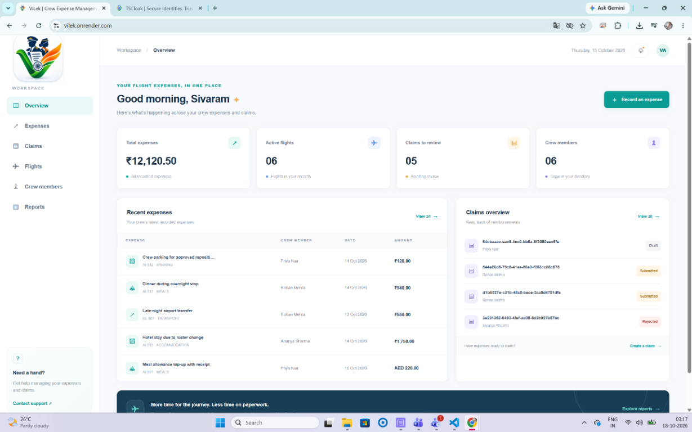
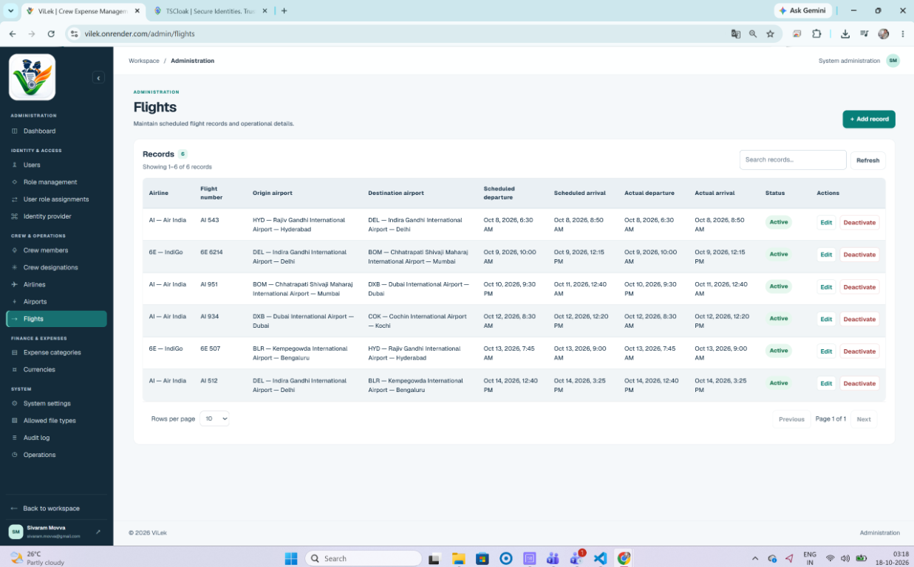
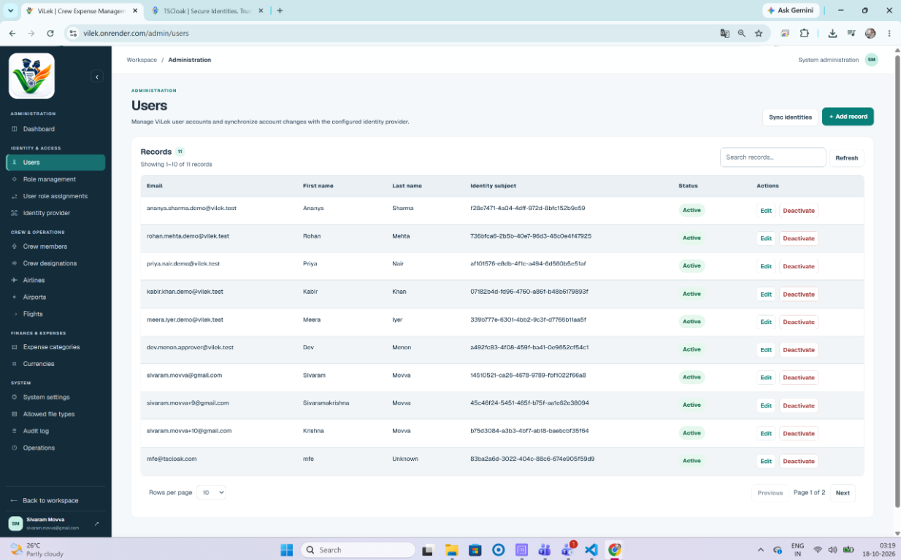
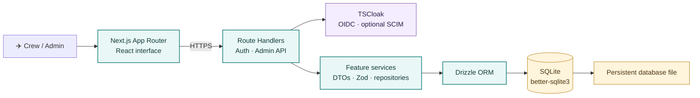
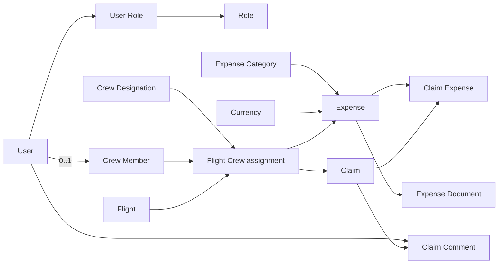

<a id="overview"></a>

<div align="center">

  

  <h1>ViLek · Digital Flight Ledger</h1>
  <p><strong>Fly → Track → Claim</strong></p>
  <p>A clearer way for flight crews to manage flight expenses and claims.</p>

</div>

<p align="center">
  
</p>

<p align="center">
  
  
  
  
  
</p>

## 📸 UI snapshots

### 🧭 Workspace dashboard

<p align="center">
  
</p>

<p align="center"><em>Authenticated workspace · Flight operations · Expense and claim data</em></p>

### 🛠️ Admin console

<table>
  <tr>
    <td align="center" width="50%">
      
      <strong>Flight management</strong>
    </td>
    <td align="center" width="50%">
      
      <strong>User management</strong>
    </td>
  </tr>
</table>

| [✨ Overview](#overview) | [🧭 UI & API](#ui-api) | [🏗️ Architecture](#architecture) | [🗃️ Database](#database) | [🚀 Setup](#setup) |
|:---:|:---:|:---:|:---:|:---:|

## ✨ What ViLek is

ViLek is a full-stack web application for flight-crew operations and expense/claim management. The current codebase includes an authenticated workspace dashboard and a data-backed administrator console. The database already models flights, crew assignments, expenses, documents, and claims; not all of those domain workflows have end-user screens or APIs yet.

> [!NOTE]
> The implementation—not the roadmap or mock navigation—is the source of truth for what is available today. The workspace dashboard reads expense and claim data, but expense entry, claim submission/approval, and document-upload APIs are not implemented yet.

<a id="ui-api"></a>

## 🧭 Current implementation

### 🖥️ User interface

- `/login` — sign in through the configured TSCloak OpenID Connect provider.
- `/` — requires a locally authenticated ViLek user and shows summary counts, recent expenses, and recent claims from SQLite.
- `/admin` — ADMIN-only overview with live record counts and links to management pages.
- `/admin/users` — local users, account active state, OIDC linkage, and guarded SCIM reconciliation.
- `/admin/roles` and `/admin/user-roles` — manage predefined roles and local role assignments.
- `/admin/identity-provider` — read-only, non-secret TSCloak configuration summary.
- `/admin/crew-members`, `/admin/crew-designations`, `/admin/airlines`, `/admin/airports`, `/admin/flights` — manage operational reference records.
- `/admin/expense-categories`, `/admin/currencies` — manage finance reference records.
- `/admin/settings`, `/admin/file-types` — configure the default currency, maximum upload size, and permitted file extensions.
- `/admin/audit-log`, `/admin/operations` — inspect recent outbox records and outbox delivery status; both are read-only.

The administrator shell has grouped navigation, a collapsible desktop sidebar, a responsive drawer, breadcrumbs, and account/logout controls. Feature pages use shared patterns for forms, tables, feedback, and validation. Several admin forms use React Hook Form and TanStack Query; request validation is performed on the server as well.

### 🔌 HTTP API

All application endpoints are Next.js App Router Route Handlers under `src/app/api/`.

| Endpoint | Methods | Purpose |
|---|---|---|
| `/api/auth/login` | `GET` | Start OIDC sign-in. |
| `/api/auth/callback/tscloak` | `GET` | Complete the TSCloak callback and establish the local session cookie. |
| `/api/auth/me` | `GET` | Return the current authenticated local identity. |
| `/api/auth/logout` | `POST` | Clear ViLek authentication cookies and sign out locally. |
| `/api/admin/{airlines,airports,crew-designations,crew-members,currencies,expense-categories,flights,roles,users}` | `GET`, `POST` | Protected resource collection handlers; supported writes depend on the resource and its validation rules. |
| `/api/admin/{resource}/[id]` | `PATCH`, `DELETE` | Update or deactivate an individual managed record for supported resources. `DELETE` is used as deactivation where preserving history matters. |
| `/api/admin/flights/options` | `GET` | Return options used by flight administration. |
| `/api/admin/user-roles` | `GET`, `POST` | List and assign local roles. |
| `/api/admin/user-roles/[id]` | `DELETE` | Remove a local role assignment, subject to administrator safeguards. |
| `/api/admin/users/sync` | `POST` | Reconcile eligible existing local accounts with TSCloak SCIM identities. |
| `/api/admin/system-settings` | `GET`, `PUT` | Read or update system settings. |
| `/api/admin/file-types` | `GET`, `POST` | List or allow a file extension. |
| `/api/admin/file-types/[id]` | `DELETE` | Remove an allowed file extension. |
| `/api/admin/identity-provider` | `GET` | Return safe provider configuration metadata. |
| `/api/admin/audit-log` | `GET` | Read recent `Audit_Outbox` records. |
| `/api/admin/operations` | `GET` | Read outbox pending/error counts and delivery records. |

The admin endpoint pattern above is not a promise that every resource supports every mutation. The UI/resource configuration and the handler's DTO/schema define the actual contract. There are currently no expense CRUD, claim workflow, or expense-document upload endpoints.

Admin APIs are protected independently of page/layout protection. They use the shared route guard, local role/permission checks, server-side input validation, and same-origin `Origin` checks for cookie-authenticated mutations. Consult [AUTHORIZATION.md](./docs/AUTHORIZATION.md) and [DTO-ZOD-CONTRACTS.md](./docs/DTO-ZOD-CONTRACTS.md) for the contract and security rules.

<a id="architecture"></a>

## 🏗️ Architecture



| Concern | Implementation |
|---|---|
| Web framework | Next.js 16 App Router |
| UI/runtime | React 19, TypeScript |
| Styling | Tailwind CSS 4 plus application CSS |
| Database | SQLite through `better-sqlite3` |
| ORM and migrations | Drizzle ORM and Drizzle Kit |
| Runtime validation | Zod |
| Admin data access | Feature DTOs, schemas, services, repositories, and Route Handlers |
| Identity | TSCloak using OIDC; optional SCIM for guarded account reconciliation/seeding |
| UI data/forms | TanStack Query and React Hook Form on relevant admin pages |

Database access is server-only. `src/lib/db/client.ts` opens the SQLite connection, turns on foreign-key enforcement and WAL mode, and exports the typed Drizzle client. Feature code is organized under `src/lib/admin/features/`; UI and HTTP routes are under `src/components/` and `src/app/`.

<a id="database"></a>

## 🗃️ Database schema

The source schema is [`src/lib/db/schema.ts`](./src/lib/db/schema.ts); generated SQL migrations are in [`drizzle/`](./drizzle/). It defines 22 SQLite tables.

### Tables and relationships

| Table | Columns (SQLite types; `?` means nullable) |
|---|---|
| `Gender` | `id INTEGER PK`, `code TEXT UNIQUE`, `name TEXT`, `is_active INTEGER`. |
| `User` | `id TEXT PK`, `oidc_subject TEXT? UNIQUE`, `email TEXT UNIQUE`, `first_name TEXT`, `last_name TEXT`, `date_of_birth TEXT?`, `gender_id INTEGER? FK`, `is_active INTEGER`, `created_at TEXT`, `updated_at TEXT`. |
| `Role` | `id INTEGER PK`, `code TEXT UNIQUE`, `name TEXT`, `description TEXT?`, `is_active INTEGER`. |
| `User_Role` | `id INTEGER PK`, `user_id TEXT FK`, `role_id INTEGER FK`, `created_at TEXT`; unique `(user_id, role_id)`. |
| `Crew_Member` | `id TEXT PK`, `user_id TEXT UNIQUE FK`, `badge_number TEXT UNIQUE`, `is_active INTEGER`, `created_at TEXT`, `updated_at TEXT`. |
| `Airline` | `id INTEGER PK`, `iata_code TEXT UNIQUE`, `icao_code TEXT UNIQUE`, `name TEXT`, `is_active INTEGER`. |
| `Airport` | `id INTEGER PK`, `iata_code TEXT UNIQUE`, `icao_code TEXT UNIQUE`, `name TEXT`, `city TEXT`, `country TEXT`, `time_zone TEXT`, `is_active INTEGER`. |
| `Flight` | `id TEXT PK`, `airline_id INTEGER FK`, `flight_number TEXT`, `origin_airport_id INTEGER FK`, `destination_airport_id INTEGER FK`, `scheduled_departure TEXT`, `scheduled_arrival TEXT`, `actual_departure TEXT?`, `actual_arrival TEXT?`, `is_active INTEGER`. |
| `Crew_Designation` | `id INTEGER PK`, `code TEXT UNIQUE`, `name TEXT`, `is_active INTEGER`. |
| `Flight_Crew` | `id TEXT PK`, `flight_id TEXT FK`, `crew_member_id TEXT FK`, `designation_id INTEGER FK`, `created_at TEXT`; unique `(flight_id, crew_member_id)`. |
| `Currency` | `id INTEGER PK`, `code TEXT UNIQUE`, `name TEXT`, `minor_units INTEGER` (default `2`), `is_active INTEGER`. |
| `Expense_Category` | `id INTEGER PK`, `code TEXT UNIQUE`, `name TEXT`, `is_active INTEGER`. |
| `Expense` | `id TEXT PK`, `flight_crew_id TEXT FK`, `amount TEXT`, `original_currency_id INTEGER FK`, `expense_date TEXT`, `location TEXT?`, `category_id INTEGER FK`, `description TEXT`, `created_at TEXT`, `updated_at TEXT`. |
| `Expense_Document` | `id TEXT PK`, `expense_id TEXT FK`, `document_type TEXT`, `storage_key TEXT`, `file_name TEXT`, `content_type TEXT`, `file_size_bytes INTEGER`, `uploaded_at TEXT`. |
| `Claim` | `id TEXT PK`, `flight_crew_id TEXT UNIQUE FK`, `status TEXT` (default `DRAFT`), `created_at TEXT`, `updated_at TEXT`. |
| `Claim_Expense` | `id TEXT PK`, `claim_id TEXT FK`, `expense_id TEXT UNIQUE FK`, `created_at TEXT`; unique `(claim_id, expense_id)`. |
| `Claim_Comment` | `id TEXT PK`, `claim_id TEXT FK`, `user_id TEXT FK`, `comment TEXT`, `created_at TEXT`. |
| `Deployment_Setup` | `id INTEGER PK` (only `1` allowed), `setup_completed_at TEXT?`, `created_at TEXT`, `updated_at TEXT`. |
| `System_Setting` | `id INTEGER PK` (only `1` allowed), `default_currency_id INTEGER FK`, `max_upload_size_bytes INTEGER` (default `10485760`), `updated_at TEXT`. |
| `Allowed_File_Type` | `id INTEGER PK`, `system_setting_id INTEGER FK`, `file_type TEXT`; unique `(system_setting_id, file_type)`. |
| `Notification` | `id TEXT PK`, `user_id TEXT FK`, `type TEXT`, `title TEXT`, `message TEXT`, `target_type TEXT?`, `target_id TEXT?`, `created_at TEXT`, `read_at TEXT?`. |
| `Audit_Outbox` | `id TEXT PK`, `entity_type TEXT`, `entity_id TEXT`, `event_type TEXT`, `payload_json TEXT`, `correlation_id TEXT?`, `actor_user_id TEXT? FK`, `created_at TEXT`, `processed_at TEXT?`, `attempt_count INTEGER`, `next_attempt_at TEXT?`, `last_error TEXT?`. |

#### ✈️ Core domain relationships



`Flight_Crew` is the key ownership boundary for expense and claim data: it provides the particular person, flight, and designation context for a record. An expense does not duplicate separate crew-member and flight IDs.

### Types, constraints, and delete behavior

- Operational record IDs are generally UUID text; lookup/master-data IDs are integer autoincrement keys.
- Date/time values and timestamps use text columns (ISO-8601 values are the application convention). SQLite defaults generate UTC timestamps for standard created/updated fields.
- Expense `amount` is stored as text and checked to be non-negative; it is not stored as a SQLite `REAL` column. Currency precision is held in `Currency.minor_units` (0–4).
- Foreign keys are enabled at connection startup. Relationships use explicit `CASCADE`, `RESTRICT`, or `SET NULL` behavior as appropriate.
- Uniqueness and check constraints enforce such rules as airline/airport code lengths, currency precision, non-negative file sizes, positive upload limits, singleton configuration rows, unique flight assignments, and one claim per assignment.
- Master/reference records are normally deactivated rather than physically deleted so historical records retain their references. The API also prevents removal of the last active administrator assignment.

## 🔐 Authentication and authorization

TSCloak authenticates the person; ViLek authorizes the person. The application resolves the OIDC subject to a local `User`, then obtains active local role assignments from `User_Role` and `Role`. TSCloak role claims are not used for ViLek authorization.

| Local role | Current permission scope |
|---|---|
| `ADMIN` | All permissions declared by the application. |
| `CREW` | Read and create claim permissions. |
| `APPROVER` | Read and review claim permissions. |
| `FINANCE` | Read claims and process finance permissions. |
| `FLIGHT_OPERATIONS_MANAGER` | Crew, designation, airline, airport, and flight operations permissions. |

The administrator UI currently requires the local `ADMIN` role. Role codes and permission grants are application-policy decisions in `src/lib/auth/permissions.ts`; administrators can manage predefined role metadata and assign roles, but cannot edit the permission matrix in the UI.

OIDC access tokens are held in an HttpOnly cookie; production cookies are Secure and use SameSite=Lax. Cookie-authenticated mutations require a matching `Origin`. Explicit Bearer-token clients use the API-client path and do not use the browser Origin check.

## 🧠 Decisions and trade-offs

These describe current code and documented decisions, not guarantees about future infrastructure.

1. **Assignment-scoped expense ownership.** The crew member's designation belongs to a particular `Flight_Crew` assignment. Expenses and claims reference that assignment, avoiding ambiguous or duplicated flight/person context.
2. **Separate identity from application access.** TSCloak verifies identity; local user records and local role assignments determine ViLek permissions. External identity synchronization does not assign application roles.
3. **Local permissions stay code-defined.** Role-to-permission mapping is deliberately conservative and reviewable in code, rather than configurable as an editable permission matrix.
4. **SQLite is the active database.** The initial deployment uses a local SQLite file, `better-sqlite3`, and Drizzle. The active adapter explicitly rejects non-`file:` database URLs; PostgreSQL portability is not currently implemented.
5. **Prefer preserving operational history.** Admin “delete” actions deactivate master data where historical references matter; foreign-key delete rules add another layer of protection.
6. **Validate at the boundary.** Admin request payloads use server-side Zod schemas and DTOs, with database constraints for durable invariants.
7. **Keep the admin surface narrow.** SCIM reconciliation only matches eligible existing local users and does not create local access assignments. Provider details omit secrets; outbox views are read-only.
8. **Separate configuration from completed workflows.** Upload settings and document metadata are modeled, but there is no upload handler or background outbox worker. Configuration alone does not enforce file policy or deliver events.
9. **Use a single claim per assignment and one claim per expense.** The schema's unique indexes encode these current workflow assumptions.

<a id="setup"></a>

## 🚀 Local development

### ✅ Prerequisites

- Node.js and npm (use a Node.js version compatible with the installed Next.js release).
- Access to a TSCloak OIDC client for interactive login.

SQLite is embedded; a separate database server is not required.

### ⚙️ Install and configure

```powershell
npm install
```

Create `.env` in the repository root. At minimum, for local database access and OIDC login:

```dotenv
DATABASE_URL=file:./data/vilek.db
TSCLOAK_ISSUER=https://tscloak.onrender.com
TSCLOAK_CLIENT_ID=your-vilek-client-id
TSCLOAK_CLIENT_SECRET=your-vilek-client-secret
TSCLOAK_REDIRECT_URI=http://localhost:3001/api/auth/callback/tscloak
TSCLOAK_POST_LOGOUT_REDIRECT_URI=http://localhost:3001/login
VILEK_BASE_URL=http://localhost:3001
```

`DATABASE_URL` defaults to `file:./data/vilek.db`. Relative file paths are resolved from the process working directory. Keep credentials private; `.env*` files are excluded by `.gitignore`.

| Variable | Purpose |
|---|---|
| `DATABASE_URL` | SQLite file URL; non-`file:` URLs are rejected. |
| `TSCLOAK_ISSUER` | OIDC issuer URL; defaults to `https://tscloak.onrender.com`. Must match the issuer in provider tokens. |
| `TSCLOAK_CLIENT_ID`, `TSCLOAK_CLIENT_SECRET` | OIDC client credentials. |
| `TSCLOAK_ACCESS_TOKEN_AUDIENCE` | Expected token audience; defaults to the client ID. |
| `TSCLOAK_REDIRECT_URI` | Registered OIDC callback; defaults to the local port 3001 callback. |
| `TSCLOAK_POST_LOGOUT_REDIRECT_URI` | Local post-logout redirect; defaults to `http://localhost:3001/login`. |
| `TSCLOAK_SCOPES` | OIDC scopes; defaults to `openid profile email`. |
| `TSCLOAK_TOKEN_AUTH_METHOD` | OIDC token endpoint auth method: `client_secret_post` (default) or `client_secret_basic`. |
| `VILEK_BASE_URL` | Public application base URL for login/callback and expected browser origin; set it to the deployed HTTPS origin in production. |
| `TSCLOAK_SCIM_ENABLED` | Must be exactly `true` to enable the SCIM sync/seed operations. |
| `TSCLOAK_SCIM_CLIENT_ID`, `TSCLOAK_SCIM_CLIENT_SECRET` | Credentials for the SCIM client-credentials flow. The documented seed setup requires the SCIM client ID to match `TSCLOAK_CLIENT_ID`. |
| `TSCLOAK_SCIM_TOKEN_AUTH_METHOD` | SCIM token endpoint auth method: `client_secret_post` (default) or `client_secret_basic`. |

Register the callback URI and post-logout URI with the identity provider. In production, also configure the public base URL and HTTPS redirects; do not deploy with the local defaults.

### 🧰 Database and app commands

```powershell
npm run db:migrate
npm run dev
```

The development server listens at `http://localhost:3001`.

| Command | What it does |
|---|---|
| `npm run dev` | Start the Next.js development server on port 3001. |
| `npm run build` | Create a production build. |
| `npm run start` | Start the production server on port 3001. |
| `npm run lint` | Run ESLint. |
| `npm run typecheck` | Run TypeScript without emitting output. |
| `npm run db:generate` | Generate a Drizzle migration from the schema. Review the generated SQL before applying it. |
| `npm run db:migrate` | Apply migrations in `drizzle/` to the configured SQLite database. |
| `npm run db:studio` | Open Drizzle Studio for the configured database. |
| `npm run db:seed` | Provision demo users through SCIM, then seed local demo data. Requires explicit SCIM configuration and changes the configured identity provider. |

For a code change, run the focused checks as appropriate; the usual pre-deployment checks are:

```powershell
npm run typecheck
npm run lint
npm run build
```

### ⚠️ Demo seed warning

`npm run db:seed` is not a local-only fixture command: it contacts the configured TSCloak SCIM API before writing seed data. It refuses to run unless `TSCLOAK_SCIM_ENABLED=true` and valid SCIM credentials are supplied. Use a test identity provider only, and review [SCIM-SEEDING.md](./SCIM-SEEDING.md) before running it. The script provisions fictional `.test` identities, creates local role/reference/demo records, and never sets passwords. Confirm the provider's SCIM resource `id` is the same value as the OIDC `sub` before relying on the subject mapping.

## ☁️ Migrations and deployment

1. Edit the Drizzle schema and review the impact on existing records.
2. Generate a migration with `npm run db:generate`; review the SQL in `drizzle/`.
3. Apply and verify it against a development database with `npm run db:migrate`.
4. Back up the production SQLite file before risky migrations, then apply migrations in a controlled deploy step.
5. Verify that the running service reads and writes the intended persistent database file.

SQLite requires durable storage in production. A container's ephemeral filesystem can lose the database on restart or redeploy; configure a persistent volume/disk and set `DATABASE_URL` to a file path on that storage. Backups, restore testing, and a migration process are deployment responsibilities.

Render has been considered as a hosting target, and an EC2/Apache reverse-proxy setup has also been explored; this README does not imply that either production deployment is complete. Behind a proxy, configure the canonical `VILEK_BASE_URL`, OIDC redirect URIs, and forwarded host/protocol behavior, then test login/logout redirects through the public HTTPS URL.

## 🗂️ Repository map

```text
src/
  app/
    api/                 Authentication and admin Route Handlers
    admin/               Admin route pages
    login/               Sign-in page
    page.tsx             Authenticated workspace dashboard
  components/
    admin/               Shared admin shell and feature pages
  lib/
    admin/features/      DTOs, Zod schemas, services, repositories
    auth/                TSCloak token handling and local authorization
    db/                  SQLite connection, Drizzle schema, migrate, seed
drizzle/                 Versioned SQL migrations
docs/                    Implementation, auth, UI, and contract notes
public/Branding/          Logo and product imagery
```

## 📚 Project notes

- [AUTHORIZATION.md](./docs/AUTHORIZATION.md) — local roles, permissions, guards, and API protection.
- [ADMIN-UI.md](./docs/ADMIN-UI.md) — admin routes, behavior, and known limitations.
- [ADMIN-IMPLEMENTATION-2026-10-16.md](./docs/ADMIN-IMPLEMENTATION-2026-10-16.md) — implemented admin scope and operational caveats.
- [DTO-ZOD-CONTRACTS.md](./docs/DTO-ZOD-CONTRACTS.md) — DTO and runtime validation conventions.
- [SCIM-SEEDING.md](./SCIM-SEEDING.md) — demo-user provisioning, setup, and identity-mapping cautions.

## 🛣️ Not implemented yet

- Expense create/read/update/delete screens and API endpoints.
- Expense receipt/document upload, download, and storage access controls.
- Claim creation, submission, approval/review, and finance processing workflows.
- User-facing flight and crew assignment management.
- Durable upload-policy enforcement (the configuration exists, but there is no upload endpoint).
- Audit-event production for every admin mutation or a background outbox delivery/retry worker.
- Production database backup/restore automation and a verified persistent-volume deployment.

Do not treat the presence of a schema table, dashboard navigation label, permission constant, or configuration value as proof that the corresponding workflow is complete.

## 📄 License

License information will be added when the project license is finalized.
